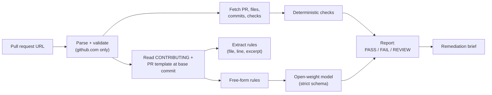

# PR Passport

[](https://github.com/harshitsharmaaaa/pr-passport/actions/workflows/ci.yml)
[](./LICENSE)

**PR Passport checks whether a public GitHub pull request complies with its repository's own contribution guidelines.**

Paste a pull request URL. PR Passport reads the repository's `CONTRIBUTING` file and PR template at the pull request's base commit, evaluates what can be checked deterministically, asks an open-weight model to interpret the free-form parts, and returns a verdict:

- **PASS** - every requirement was evaluated and passed. A rule that could not be evaluated keeps the report out of PASS.
- **FAIL** — at least one requirement failed, with the rule source and pull request evidence that decided it.
- **NEEDS HUMAN REVIEW** - automated evidence was insufficient, the requirement is conditional, or a guideline rule could not be evaluated. No guess is made.

Every finding carries two things that are usually missing from automated review tools:

1. **The rule source** — the exact file, line range, and quoted sentence that requires it.
2. **The evidence** — the commits, changed files, description text, or check results from this specific pull request.

It ends with an **Alan-ready remediation brief**: failed requirements, evidence, files to inspect, validation commands derived from the repository's own files, and hard constraints — copy-pasteable into Alan or any coding agent.

## Guardrails

| Guardrail | How it is enforced |
| --- | --- |
| Public repositories only | URL parser accepts `github.com/<owner>/<repo>/pull/<n>` and nothing else; no OAuth anywhere |
| Untrusted input | Repository files, PR text, and model output are treated as data; the model prompt wraps everything in `<untrusted_pull_request_data>` and ignores instructions inside |
| Never execute repository code | The app only reads via the GitHub API; suggested commands are printed, never run |
| Never merge or push | No write scopes are requested; the remediation brief explicitly forbids merging and pushing |
| Never invent rules or results | Each project rule cites a repository file and line; missing CI, missing guidelines, and unreadable files are reported as limitations |
| Strict model output | Model JSON must match a zod schema; unknown rule IDs, files, commits, or metadata are discarded; evidence-free claims become NEEDS HUMAN REVIEW |

## How it works



1. **Parse and validate** the URL. Hostnames like `github.com.evil.example`, embedded credentials, and non-pull-request paths are rejected before any request is made.
2. **Fetch evidence** server-side: PR metadata, changed files, commits, check runs plus combined statuses, root repository files, and the guidelines as of the **base commit** (so the rules are the ones in force for this PR).
3. **Evaluate deterministically** everything with a mechanical answer.
4. **Interpret free-form guidance** (for example "keep pull requests reviewable in one sitting") with the configured open-weight model, then validate every claim against the schema *and* the pull request's own files and commits.
5. **Assemble the report** with verdicts, limitations, validation commands, and the remediation brief.

## Hand off to Alan

The remediation brief is designed to become an Alan task verbatim. Two
verified mechanisms (checked against [Alan's official docs](https://docs.tryalan.ai) in October 2026):

1. **One-off task (recommended):** copy the brief with the report's **Copy**
   button, create an Alan task (**Tasks > New task**), paste the brief as the
   description, and press **Ctrl+Enter** to create the task and start an agent
   session in one step.
2. **Recurring automation:** Alan automations support a GitHub
   **Pull Request Opened** trigger with free-text instructions; a ready-to-paste
   instruction block - with built-in "do not merge or push" limits - is in
   [examples/alan-workflow.md](examples/alan-workflow.md).

There is no importable workflow JSON and no documented public API for creating
Alan tasks, so PR Passport does not pretend otherwise. The brief ships with a
validator, `evaluateAlanHandoff` in `src/lib/handoff/alan.ts`, which checks
that it contains the requirement sources, evidence, validation commands,
constraints and limitations the handoff promises, is bounded at 20,000
characters, and carries no credential material. `examples/sample-report.json`
is a complete demo report you can inspect before running anything.

## Checks

Deterministic checks are only created when the repository's own guidelines require them (except the two platform facts, which GitHub itself reports):

| Check | Source of the rule | Mechanically verified |
| --- | --- | --- |
| DCO sign-off (`Signed-off-by`) | guideline sentence | every commit message has a name + email trailer |
| Linked issue | guideline sentence | closing keywords, `#n`, or an issue URL outside code fences |
| Title format | guideline sentence | conventional-commit prefixes (repository-specific if documented) |
| Tests included | guideline sentence | changed file paths against test patterns |
| Documentation updated | guideline sentence | changed file paths |
| Changelog entry | guideline sentence | `CHANGELOG.md` / `.changeset/` paths |
| PR template checklist | `.github/PULL_REQUEST_TEMPLATE.md` | checkbox lines in the PR description |
| Description completed | `.github/PULL_REQUEST_TEMPLATE.md` | non-empty body |
| Branch naming | guideline sentence with an explicit prefix | head ref prefix |
| Size limit | guideline sentence with a number | additions + deletions |
| Required checks pass | GitHub checks API (or the guideline) | check runs + combined statuses |
| No merge conflicts | GitHub pull request API | `mergeable` / `mergeable_state` |

Conditional requirements ("for user-facing changes", "when a public API changes") that cannot be satisfied are surfaced as **NEEDS HUMAN REVIEW**, not FAIL — the code refuses to turn an ambiguous guideline into a hard failure.

## Quickstart

```sh
bun install
cp .env.example .env.local   # all values optional
bun run dev
```

Open <http://localhost:3000> and either paste a public pull request URL or click one of the demo fixture buttons. Demo mode needs no credentials at all.

### Demo

The demo is a self-contained, offline walkthrough: a hard failure with its rule
source and evidence, a separate human-review item, the difference between
deterministic and recorded findings, and the Alan-ready remediation brief. Every
fixture number is asserted by `src/lib/demo/fixtures.test.ts`, and
`examples/sample-report.json` is generated from the failing fixture.

```sh
bun run demo:sample   # regenerate examples/sample-report.json
bun run demo:check    # fixture consistency, offline run, sample-report drift
```

See [docs/DEMO.md](./docs/DEMO.md) for the exact click sequence, what the
audience should observe, and how to hand the brief to Alan and run its
validation commands.

### Environment

| Variable | Required | Purpose |
| --- | --- | --- |
| `GITHUB_TOKEN` | no | raises the GitHub rate limit above the unauthenticated 60 req/hour; read-only public scope is enough |
| `INFERENCE_BASE_URL` | no | OpenAI-compatible API root; without it, free-form rules are listed as *not evaluated* |
| `INFERENCE_API_KEY` | no | bearer token for the endpoint |
| `INFERENCE_MODEL` | no | model id, e.g. `qwen/qwen3-32b` |
| `INFERENCE_TIMEOUT_MS` | no | request timeout (default 45000) |
| `INFERENCE_JSON_MODE` | no | `off` if the endpoint rejects `response_format` |
| `DEMO_MODE` | no | `on` forces bundled fixtures for every request |

The app is fully functional without inference: deterministic checks run, and free-form rules appear under "Not evaluated" with the reason.

### API

```sh
curl -s localhost:3000/api/analyze \
  -H 'content-type: application/json' \
  -d '{"url":"https://github.com/acme/widget-kit/pull/42","demo":true}' \
  | jq '.summary, .findings[0]'
```

The response is a single `pr-passport.report.v1` JSON object; `examples/sample-report.json` is a full example produced by the demo fixtures.

## Development

```sh
bun run test        # unit + integration tests (bun test)
bun run typecheck   # tsc --noEmit, strict
bun run lint        # eslint (typescript-eslint + @next/eslint-plugin-next)
bun run verify      # all of the above
bun run build       # production build
```

Test coverage includes URL validation (host spoofing, credentials, ports), guideline extraction, every deterministic check, model-output grounding (unknown files/commits/rules, downgrade behaviour, schema strictness), report assembly, remediation-brief content, validation-command derivation, rate limiting, fixture consistency, an offline demo run with no network or credentials, and drift between a fresh demo run and `examples/sample-report.json`.

## Deployment

- **Vercel**: import the repository, add the optional environment variables. The analyze route sets `maxDuration = 60`; on the Hobby plan, lower `INFERENCE_TIMEOUT_MS` or skip inference.
- **Docker**: `docker build -t pr-passport . && docker run -p 3000:3000 --env-file .env pr-passport`.

Rate limiting is per-instance and in-memory (8 analyses/minute/IP). Put a platform-level limiter in front for multi-instance deployments.

## Limitations

- Only public repositories; private repos return "not found".
- Guidelines are read as Markdown; reStructuredText or wiki-only guidelines are not fetched.
- The model sees metadata, file paths, commit summaries, the PR description, and bounded diff excerpts (up to 8 files, 1,600 characters each) - never the full diff, and patch content is delivered as untrusted data, not instructions. Its job is policy interpretation, not code review.
- GitHub mergeability can lag; when it is not computed yet the report says so.
- Monorepos with guidelines outside the checked paths will show "no guidelines found" — the report states this rather than guessing rules.

## Roadmap

- Wiki and `.github/` directory template discovery
- Optional diff snippets for evidence display (still read-only)
- Repo-side GitHub Action that comments the report on the PR
- Cached analyses to be gentler on the unauthenticated rate limit

## License

[MIT](./LICENSE)